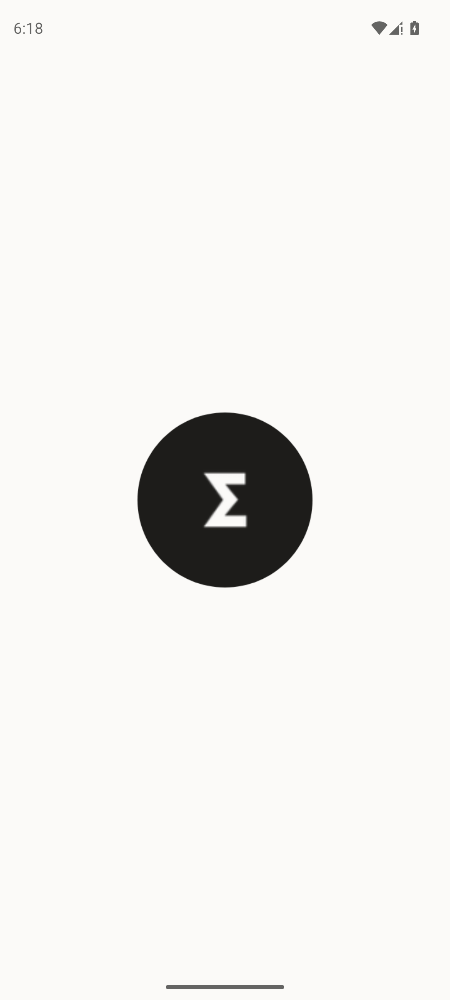
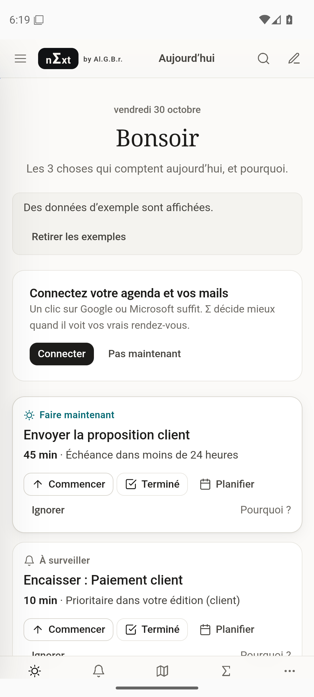
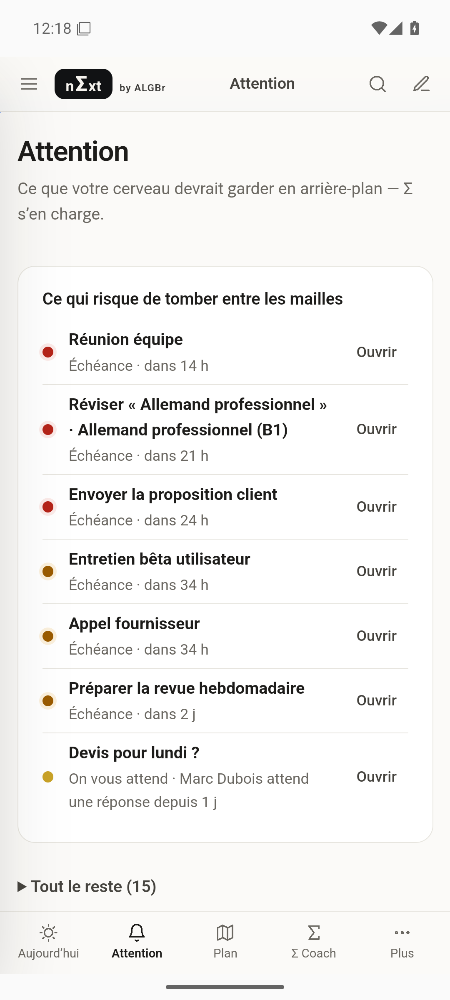
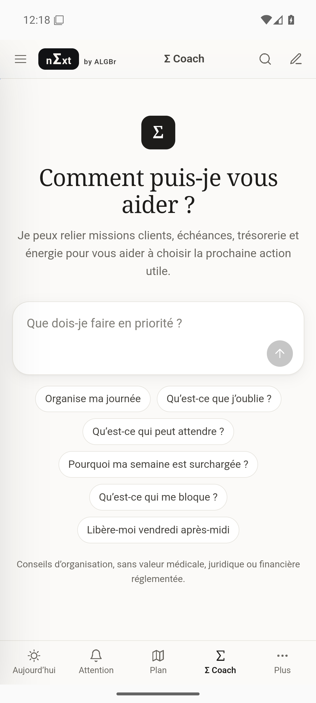
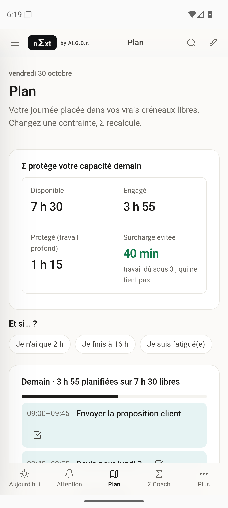
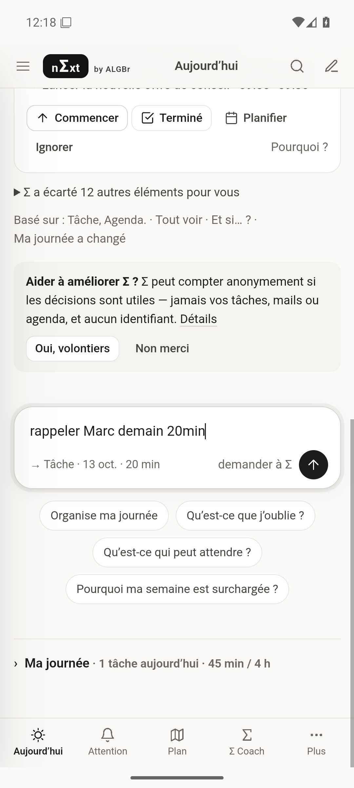
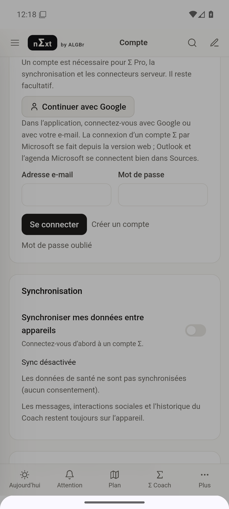

# NEXT — test Android (sdk_gphone64_x86_64)

- ✅ opens on the app, not the landing page — `https://localhost/`
- ✅ Today shows three decisions
- ✅ attention renders
- ✅ plan renders
- ✅ coach renders
- ✅ back button goes back inside the app — `#plan`
- ✅ capture preview shows a task
- ✅ Google sign-in button is offered in the app
- ✅ Google sign-in opens a native screen (not a blocked web page) — `mCurrentFocus=Window{1f34b47 u0 com.google.android.gms/com.google.android.gms.auth.api.credentials.assistedsignin.ui.GoogleSignInActivity}`
- ✅ no JavaScript errors

